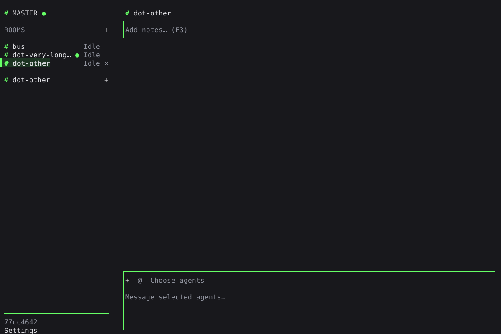
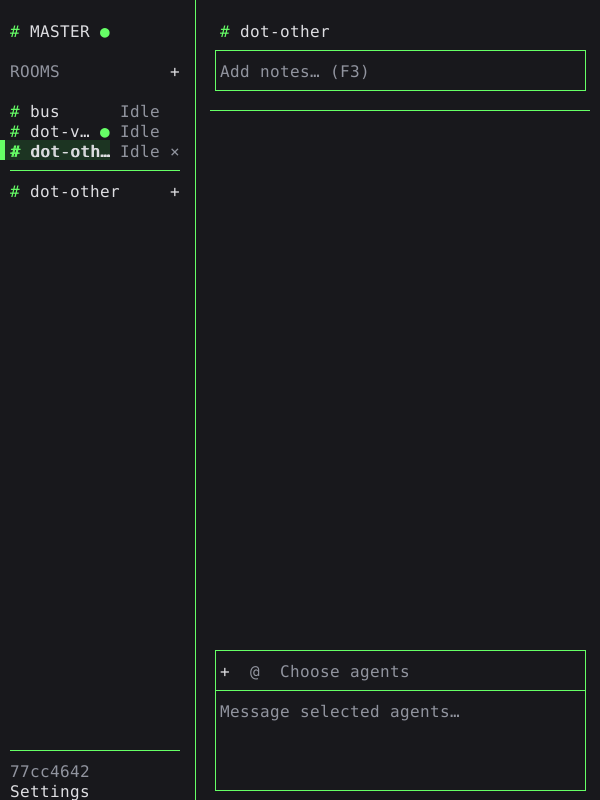
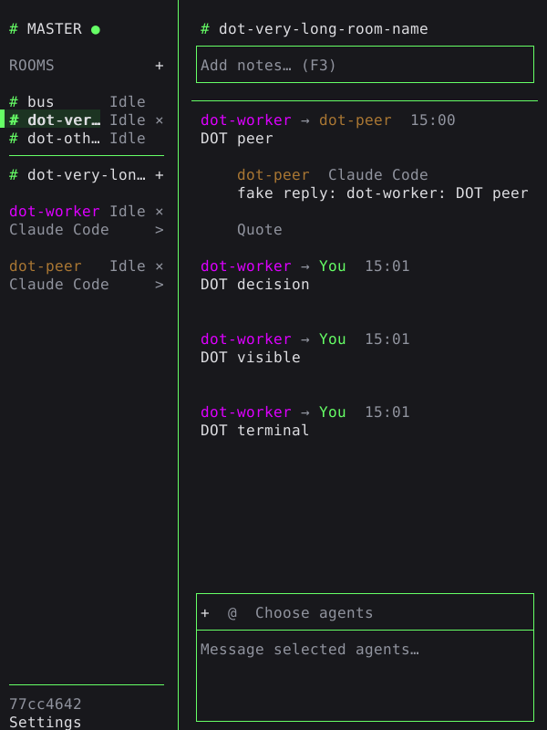

# Room messages to You

A green dot after a sidebar room name means that room has an unseen message
addressed to You, including a Bus notice. MASTER follows the same rule. Opening
the room through its sidebar entry or returning from an agent terminal with F6
clears the dot. Messages arriving while the room is visible do not set it.
The server saves the marker across server and TUI restarts.

Peer messages and their replies can increase `bus state`'s existing `unread_count`
without setting the dot. The separate `unseen_to_developer` field is the dot's
persisted state. Legacy saved rooms start with it clear.

The room name truncates before the dot. In very narrow sidebars, the status
truncates first so it cannot overwrite the dot.

Returning to the room with F6 clears its dot while MASTER's remains.

