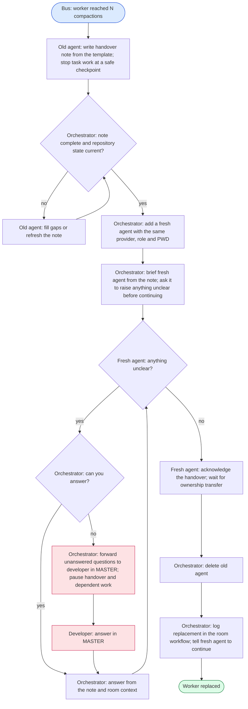

# Workflow: agent-handover

This workflow is a skill for the orchestrator: it shows how to replace a worker
without losing the details of its current task. Automatically follow it when Bus
sends `AGENT -> orchestrator: reached N compactions; get a handover note and
replace it.` at **Settings → Max compactions per agent**. No new approval is
needed for this replacement. It applies only to workers: the orchestrator never
clears or replaces itself, and clearing a worker is not a substitute.

The orchestrator already has broad-stroke context about what's been done and
what's next, so those sections of the note are short, one-sentence bullets.
**What's ongoing now** carries the detail the orchestrator does not have.
Follow the steps and decisions below, using judgment for names and recovery.

## Graph

Ask the old agent to copy [handover-template.md](handover-template.md) to
`temp/handover/<agent>-<date>.md` in its PWD, using its agent name and a
`YYYY-MM-DD` date. Use a distinct suffix if that path already holds a different
handover. Record the absolute note path so the orchestrator and fresh agent can
both read it. The old agent finishes or safely stops in-flight work, records
anything still running, and makes no further task changes after writing the
note unless asked to refresh it.

Read the whole note before adding the replacement. Check that it covers the
exact current step, running or half-done work, touched files, commands in flight,
open questions, and gotchas. Every worktree and branch involved in the task
must have its current full commit hash recorded, including branches not checked
out. Every staged, unstaged, and untracked change must be listed and classified
as either **part of the task: commit-and-push when done** or **exploratory: safe
to stash**. Have the old agent verify the snapshot against Git and resolve gaps;
do not assume an omitted worktree is clean or automatically stash anything.

Use `bus agent add --room ROOM --name NEW --provider PROVIDER --pwd PWD`
with the old agent's provider and exact PWD, preserving its task role in the
brief. Start a fresh session; do not resume the old context. Brief it with the
note's absolute path, the task goal and boundaries, and this instruction:
"Read the handover note and ask questions about anything unclear before
continuing. Wait for ownership transfer before changing files or running task
commands."

The orchestrator is expected to answer most questions itself from its
broad-stroke context, the note, and the room history. Only questions it cannot
answer go to the developer in MASTER. Pause this handover and any work that
depends on those answers until the developer replies; relay the answers to the
fresh agent before continuing. Keep the old agent available through this check.

After the fresh agent understands the handover, run
`bus agent delete OLD --confirm`. Deleting the agent does not authorize deleting
worktrees, branches, files, or uncommitted changes. Log the date, compaction
notice, old → new agent names, provider, role, PWD, and absolute note path in the
room's running workflow log, update its participants and room notes, then tell
the fresh agent to continue from the recorded current step.

## Failure recovery

- **Unanswered question:** the developer answers in MASTER; the orchestrator
  relays the answer and resumes the paused handover at the question check.

## Orchestrator failure recovery

You handle these yourself:

- **Incomplete or stale note:** ask the old agent to fill the missing details
  or refresh the Git snapshot, then read and check it again before proceeding.
- **Agent add or briefing failed:** keep the old agent and all repository state
  intact, resolve the failure, and retry from the failed step; do not start two
  workers writing the same task.
- **Old agent unavailable:** recover the note and repository state through a
  worker without granting it task ownership yet; if essential ongoing details
  cannot be recovered, ask the developer in MASTER and pause dependent work.
- **Delete failed:** keep the fresh agent waiting for ownership transfer and
  retry deletion before logging a completed replacement or resuming task work.

## Participants

| Role | Model | Does |
|---|---|---|
| Orchestrator | any | Automatically starts this workflow on the worker's notice, checks the note, adds and briefs the fresh agent, answers most questions, escalates only unanswered ones to MASTER and pauses for answers, deletes the old agent, and logs the replacement; never replaces itself. |
| Old agent | existing provider | Writes the detailed note and complete repository snapshot, stops task changes at the handover checkpoint, and remains available until the fresh agent understands the task. |
| Fresh agent | same provider as old agent | Starts in the same PWD and role, reads the note, asks questions before continuing, and waits for ownership transfer. |
| Developer | - | Answers only questions the orchestrator cannot answer, in MASTER. |
