# Workflow: auto-merge-pr

This workflow steers one PR to "PR merged". The orchestrator supplies the locked
goal/non-goals, PR base, named peers, inherited fix-round count, merge authority
and holds. The **owner-run variant is the default**: the owner (PR author)
drives the review/repair loop and runs `merge-pr` when all gates pass. An
orchestrator-run variant uses the same gates and has the author execute the
repairs and merge. "Loop driver" below means the owner in the owner-run variant
and the orchestrator in the orchestrator-run variant. Staffing, dialogs,
recovery, out-of-goal and FLAG decisions remain with the orchestrator in both.
The binding orchestrator rules also apply.

## Graph

```mermaid
flowchart TD
    begin(["Get PR merge-ready"]):::start --> setup
    setup["Orchestrator: supply locked goal/base, peers, authority, holds and inherited fix_round"] --> mode{"Loop driver?"}
    mode -- "owner-run (default)" --> owner["Owner: drive peer review and guarded merge"]
    mode -- orchestrator-run --> orch["Orchestrator: drive the same gates; author executes"]
    owner --> init["Loop driver: record/resume PR repair log; new PR fix_round = 0"]
    orch --> init
    init --> inherited{"Inherited fix_round <= 2?"}
    inherited -- no --> cap
    inherited -- yes --> initialmeasure["Loop driver: measure diff against PR base, excluding plans/"]
    initialmeasure --> initialbig{"Total changed lines >= 3000?"}
    initialbig -- yes --> split
    initialbig -- no --> review

    subgraph round [Review and repair]
        review["Peers: review, verify and bot checks concurrently on exact head"] --> scope{"Any finding outside locked goal?"}
        scope -- yes --> defer["Owner: exclude from PR; record for the final report as a follow-up"]
        defer --> flag
        scope -- no --> flag{"Anything FLAGGED or needing a developer decision?"}
        flag -- yes --> handback["Owner: stop this PR's merge path; final to orchestrator"]
        flag -- no --> ready{"Exact-head VERIFIED, all reviews Ready, gates and requested acceptance pass?"}
        ready -- no --> abandon{"Any Abandon?"}
        abandon -- yes --> handback
        abandon -- no --> pending{"Checks still running?"}
        pending -- yes --> wait["Owner: retain live peer waits and head"]
        wait --> review
        pending -- no --> budget["Loop driver: next_fix_round = fix_round + 1"]
        budget --> over{"next_fix_round > 2?"}
        over -- yes --> cap["Owner: stop; final with count, cause and plan to orchestrator"]
        over -- no --> count["Loop driver: record fix_round = next_fix_round in PR repair log"]
        count --> address["Author: address-review-comments or feedback within goal; push head directly to peers"]
        address --> measurefix["Loop driver: re-measure added + removed lines against PR base, excluding plans/"]
        measurefix --> bigfix{"Total changed lines >= 3000?"}
        bigfix -- no --> review
    end

    ready -- yes --> measure["Loop driver: re-measure diff against PR base before merging, excluding plans/"]
    measure --> big{"Total changed lines >= 3000?"}
    big -- yes --> split["Owner: stop; final to orchestrator for split-pr and recovery"]
    bigfix -- yes --> split
    big -- no --> hold{"Unresolved FLAG, other developer decision or non-manual hold?"}
    hold -- yes --> handback
    hold -- no --> manualhold{"Explicit manual-test hold?"}
    manualhold -- yes --> holdmerge["Owner: merge-pr --hold-before-merge within the inherited fix budget"]
    holdmerge --> holdready{"Ready and holding at the pinned head?"}
    holdready -- no --> holdrepairs{"Repairs required?"}
    holdrepairs -- yes --> feedback["Owner: queue preparation or manual-test feedback"]
    holdrepairs -- no --> handback
    holdready -- yes --> manualtest["Developer: manual test and merge approval"]:::developer
    manualtest --> approved{"Approved?"}
    approved -- no --> feedback
    feedback --> feedbackok{"Feedback within locked goal and no FLAG/developer decision?"}
    feedbackok -- no --> handback
    feedbackok -- yes --> budget
    approved -- yes --> approvalhead{"Approval matches the current head?"}
    approvalhead -- no --> review
    approvalhead -- yes --> release["Owner: record tested head and approval; release only its manual-test hold"]
    release --> measure
    manualhold -- no --> merge["Owner: merge-pr under recorded authority; enforce scope, FLAG, budget and size gates throughout"]
    merge --> mergedok{"PR merged?"}
    mergedok -- no --> more{"More repairs required?"}
    more -- yes --> scope
    more -- no --> handback
    mergedok -- yes --> final["Owner: MERGED final with exact head, evidence and follow-ups to orchestrator"]
    final --> mainco{"PR worktree is the main checkout?"}
    mainco -- no --> cleanup["Orchestrator: dispatch worktree-close outside PR worktree; preserve retained dependencies"]
    cleanup --> followups["Orchestrator: record and schedule follow-ups from finals"]
    mainco -- yes --> followups
    followups --> done(["PR merged"]):::success

    handback --> triage["Orchestrator: decide scope/FLAG/hold; take developer decisions to MASTER"]
    triage --> resolved{"Resolved and owner can resume under recorded authority?"}
    resolved -- yes --> review
    resolved -- no --> held(["PR held; independent work continues"]):::failure
    split --> held
    cap --> held

    classDef start fill:#dbeafe,stroke:#1d4ed8
    classDef success fill:#dcfce7,stroke:#15803d
    classDef failure fill:#fee2e2,stroke:#b91c1c
    classDef developer fill:#fde2e4,stroke:#c9184a
```

An approved workflow authorizes its path through review and merge on the exact
head: required reviews are Ready, gates and requested acceptance pass, comments
are adjudicated, and no explicit hold exists. Reuse that kickoff approval as the
start answer; do not ask for per-PR merge OK. A draft-only, manual-test or other
developer hold remains binding. Clarify missing intent or authority only for the
affected part; keep independent work moving.

For an explicit **manual-test hold**, the owner runs `merge-pr --hold-before-merge`
within the inherited fix-round budget. Once it is ready and holding, the
developer tests that exact head and approves or rejects the merge. Approval
releases only that head's manual-test hold: recheck size, current-head gates,
FLAGs and other holds before merging. If the head changes, its approval does
not carry over; review and obtain manual acceptance for the new head. Rejected
manual-test feedback and repairs found during preparation enter the same
fix-round budget gate after the scope/FLAG checks. No third fix round starts.
Other hold types still hand back to the orchestrator; a manual-test approval
does not clear them or authorize a goal change.

The loop driver records `fix_round = 0` once per new PR in its repair log and
reuses the counter on resumes and when entering from another workflow. The
owner reports the counter in finals; the orchestrator mirrors it in the workflow
log without requiring a relay for every batch. The initial review uses no
fix round. Before each repair batch, calculate `next_fix_round = fix_round + 1`;
if it exceeds two, stop this PR and send a final with the count, cause and plan
to the orchestrator while independent work continues. Otherwise record the new
counter, apply the batch and review the repaired head. The second repaired head
still gets its final review and
verification and may merge when every exact-head condition above passes.

The same counter covers review, verification, gates, bot/GitHub comments and
developer feedback. Tell the author, including while running `merge-pr`, to
return to the budget gate **before** starting another repair batch; a skill
must not silently start a third one. Several commits for one queued batch use
one round; a newly required repair after checking that head uses the next.

`deferred.md` is `<main checkout>/temp/<branch-slug>/deferred.md`, where every
character of the branch name outside `A-Za-z0-9_-` becomes `-`. It holds only
findings outside the PR goal, each with what it is and why it is out of scope.
worktree-close never removes the main checkout's `temp/`, so the link survives.

For in-goal technical disagreements without a FLAG, the owner collects peer
recommendations directly and runs best-of-n. Whatever its verdict (universal,
clear or toss-up), the author applies the top-ranked option. best-of-n keeps
the ranking in its own ledger
(`temp/best-of-n/<branch-slug>/ledger.json`, rendered as `decisions.md`).
Anything FLAGGED or needing a developer decision stops the owner-run merge
path and is sent to the orchestrator in a final. The orchestrator decides the
triage and takes product decisions to the developer; owners resume only after
resolution and fresh exact-head checks. Out-of-goal findings are never repaired
in this PR: exclude them and report them in finals for the orchestrator to
decide and record in `deferred.md` as follow-ups. Before merging, the loop driver
runs `git diff --shortstat <base>...HEAD -- . ':(exclude)plans/**'` against the
pinned PR base, adding insertions and deletions. At 3000 changed lines, stop and
hand splitting to the orchestrator. Re-measure after every pushed repair too.
These gates also constrain repairs discovered
while `merge-pr` runs; no skill may bypass them.

## Failure recovery

- **PR held: fix-round cap:** report the unresolved acceptance items, cause and
  plan in MASTER, retain the counter and name the next owner or dependency.
  Hold only this PR and its dependent operations; keep independent work moving.
- **PR merge blocked (developer recovers):** the developer starts from the
  reason you posted in MASTER, `deferred.md`, and the PR state (branch, open
  PR, latest review round, the merge-pr report if it ran).

## Orchestrator failure recovery

You handle these yourself:

- **PR split:** this run merges nothing; the parts replace the original PR.
  Run this workflow once per part and carry over the start answer instead of
  asking again. Start a part once all its parents have merged; parts with no
  open parent can run in parallel, each with its own author and reviewers.
  A part with two or more parents stays a local branch under split-pr's
  default `wait` policy until restack leaves it one base; that is expected.
  A train merges strictly bottom up, never into a parent branch; after a
  parent merges, have an agent run `split-pr restack <plan> --publish` with
  the plan path (`temp/split-pr/<source-slug>/plan.json` in the worktree where
  split-pr ran, so keep that worktree until every part is done). split-pr
  keeps the source branch until the developer authorizes cleanup; once every
  part has its PR, ask the developer in MASTER to close the original PR.
- **Split failed:** rerunning split-pr STOPs while its plan exists
  (PREFLIGHT). Have an agent fix the plan or the branch and rerun the helper
  step that failed; for a failed publish wave, restack mode with the plan path
  publishes the parts that are now publishable. A part that only a redesign
  could make independent is the developer's call.
- **Flaky test:** the author reports it and continues once a rerun passes;
  record it in `deferred.md`. After "PR merged", start the fix as its own PR,
  e.g. assign an agent to fix it in a separate worktree.
- **Usage limit mid-run:** judge by the provider's reset time. Swap another
  model into that lane, keeping the reviewers on different models, or wait for
  the reset.

## Participants

| Role | Model | Does |
|---|---|---|
| Orchestrator | any | Supplies goal/base, named peers, counter, authority and holds; owns staffing, dialogs, recovery and replacement announcements. Maintains room notes/roster and mirrors repair state from finals. Decides out-of-goal follow-ups and every FLAG, asking the developer for product decisions. In orchestrator-run mode drives the same gates; in owner-run mode receives handbacks and finals without relaying routine peer findings. Approves splits and dispatches cleanup outside the PR worktree. |
| Developer | - | Approves the workflow goal and authority or declares a hold; supplies the PR goal and non-goals when none is locked. Under a manual-test hold, tests the pinned head while merge-pr holds and approves its merge or supplies feedback that enters the inherited fix-round budget. Recovers from "PR merge blocked". |
| Owner / author | any | Drives the owner-run variant, receives peer findings directly, excludes out-of-goal repairs, hands FLAG/developer decisions back, records at most two fix rounds and re-measures against the 3000-line threshold. Runs address-review-comments, best-of-n for admitted technical issues, and merge-pr under every exact-head gate and hold. Prepares manual-test holds with merge-pr --hold-before-merge, records exact-head approval and routes rejected feedback through the budget gate; other holds go to the orchestrator. Sends milestone finals, commits reviewer tests before split/merge, and reports flaky tests without fixing unrelated code in this PR; continues only when a permitted rerun passes. |
| Verifier | any | Checks the named PR/task on each pushed head; sends VERIFIED or defects with file:line directly to the owner and a final to the orchestrator. |
| Reviewers | different models: at least Claude and Codex, Cursor optional | review-pr, each with `--reviewer` set to its own agent name. |

All agents for one PR share its worktree (any worktree, not necessarily the
main checkout); the author is the only one who commits.

## Worker brief messaging rule

Bus adds one sender header: `name:` locally, `name (room R):` across rooms or MASTER; IDs appear only for shared or numeric names. Send only the body; do not add a "from X", "X here" or signature line.
Use `--as YOUR_AGENT_ID` when messaging; `--to orchestrator` reaches your home
room's bound orchestrator, and names or IDs can reach agents in any room.

PR peers: `<PR/task> → owner <name/ID> → verifier <name/ID> → reviewer(s) <name/ID>`.
Use these peers from your brief. If one is missing or replaced, message the
orchestrator; it owns staffing, room notes, the roster and verifier allocation.
Workers do not edit room notes or the roster. The brief carries the exact head,
worktree, acceptance checklist, locked goal/non-goals, pinned PR base,
inherited `fix_round`, recorded merge authority and explicit holds.

Message peers directly. The verifier sends `VERIFIED <PR/task> @<full SHA>`
with evidence, or defects with `file:line` and reproduction, straight to the
owner (the PR author). Use the task key and worktree head before a PR exists.
Reviewers send verdicts and findings to the owner. The owner re-sends the full
head to verifier and reviewers on every push and gets current-head evidence.

If you own a PR, use the owner-run path in `auto-merge-pr` and enforce these
checks before every repair batch and merge, including inside `merge-pr`:

- Carry the inherited fix-round counter and record each batch in the PR repair
  log. Allow at most **2 fix rounds** across review, verification, gates, bots
  and developer feedback. If another repair is needed after round 2, stop and
  send a final with the count, cause and plan to the orchestrator.
- Never fix a finding outside the PR's locked goal in this PR. Exclude it and
  report it in the final as a follow-up for the orchestrator to decide and record.
- Re-measure added plus removed lines against the pinned PR base, excluding
  `plans/`, after each push and **before merging**. At **3000 lines**, stop
  and send a final to the orchestrator for splitting; do not merge.
- Hand back **anything FLAGGED or needing a developer decision** to the
  orchestrator in a final. Stop this PR's merge path until it is resolved;
  owners do not adjudicate those items themselves.
- Merge only with exact-head `VERIFIED`, every required reviewer Ready, gates
  and requested acceptance passing, comments adjudicated, recorded authority,
  no unresolved FLAG/decision and no explicit hold. This does not extend a
  workflow that ends at PR creation or waive a draft-only hold.

Before editing shared files, message their owners and read the installed
[Parallel writes](../parallel-writes.md) at the resolved absolute session path
and ownership map supplied in your brief. Finals still go to the orchestrator;
after peer-started work, also send the milestone report to `--to orchestrator`.
Staffing and recovery, dialogs, product decisions and replacement announcements
stay with the orchestrator. It updates the roster/briefs and tells affected
peers the replacement's name/ID before work resumes.
