# Workflow: auto-merge-pr

This workflow is a skill for the orchestrator: it shows how the developer wants
one PR steered to "PR merged". Follow its steps and decisions, and use your own
judgment for everything it leaves open: agent names, staffing, and how to
recover. The binding orchestrator rules also apply to this workflow.

## Graph

```mermaid
flowchart TD
    begin(["Get PR merge-ready"]):::start --> askverify
    askverify["Orchestrator: reuse approved workflow kickoff authority and explicit holds; clarify only missing intent or authority"] --> measure
    measure["Orchestrator: measure added + removed lines against the PR base branch, excluding plans/ (git diff --shortstat base...HEAD)"] --> big{"Total changed lines >= 3000?"}
    big -- yes --> split["Author: run split-pr --publish"]
    big -- no --> lockgoal["Orchestrator: confirm the PR goal and non-goals are locked from the developer's words, with the origin recorded (ask the developer once if not)"]
    lockgoal --> initround["Orchestrator: record or resume fix_round in the workflow log (new PR: 0)"]
    initround --> review
    split --> approveplan["Orchestrator: approve the split plan (split-pr CONFIRM)"]
    approveplan --> splitok{"split-pr built every part and published every publishable one?"}
    splitok -- no --> splitfailed(["Split failed (orchestrator recovers)"]):::failure
    splitok -- yes --> splitdone(["PR split (orchestrator recovers)"]):::failure

    subgraph round [Review round]
        review["Reviewers: run review-pr in parallel, each in its own lane; skip reviewers that gave Ready"]
        review --> allready{Every reviewer has given Ready?}
        allready -- no --> anyabandon{Any Abandon?}
        anyabandon -- "no (Needs Refinement)" --> queuereview[Orchestrator: queue review findings for repair]
        queuereview --> nextround["Orchestrator: next_fix_round = fix_round + 1"]
        nextround --> overbudget{"next_fix_round > 2?"}
        overbudget -- no --> startfix["Orchestrator: record fix_round = next_fix_round; start the queued repair batch"]
        startfix --> address["Author: run address-review-comments for review findings or apply developer feedback; push"]
        address --> outscope{"Orchestrator: any finding outside the PR goal?"}
        outscope -- yes --> recordscope["Orchestrator: record it in deferred.md as a follow-up PR candidate; re-send goal and non-goals to author and reviewers"]
        outscope -- no --> flag
        recordscope --> flag{Any FLAG?}
        flag -- yes --> triage[Orchestrator: triage every flagged issue]
        triage --> needsdev{"Orchestrator: any flagged issue blocking (unclear product requirements, an architectural decision, expected behavior)?"}
        needsdev -- no --> poll[Orchestrator: collect recommendations from author and reviewers, forward them to author]
        poll --> bestof[Author: run best-of-n on every flagged issue]
        bestof --> handback{best-of-n handed a question back?}
        handback -- no --> applyfirst[Author: apply the top-ranked option, push]
        flag -- no --> remeasure
        applyfirst --> remeasure
        remeasure{"Orchestrator: re-measure; total changed lines >= 3000?"}
        remeasure -- no --> review
    end

    overbudget -- yes --> holdround["Orchestrator: hold this PR; report cause and plan in MASTER; keep independent work moving"]
    holdround --> roundheld([PR held: fix-round cap]):::failure

    needsdev -- yes --> informdev
    handback -- yes --> informdev

    remeasure -- yes --> split
    anyabandon -- yes --> abandonfix{"Orchestrator: would splitting with split-pr fix every Abandon?"}
    abandonfix -- yes --> split
    abandonfix -- no --> informdev

    allready -- yes --> verify{"Explicit developer hold before merge? (kickoff approval/start answer = merge authority)"}
    verify -- yes --> holdmerge["Author: run merge-pr --hold-before-merge within the recorded fix-round budget"]
    holdmerge --> holding{merge-pr ready and holding?}
    holding -- no --> informdev
    holding -- yes --> manualtest[Developer: manual test and merge approval]:::developer
    manualtest --> approved{Approved?}
    approved -- yes --> merge
    approved -- no --> queuefeedback[Orchestrator: queue developer feedback for repair]
    queuefeedback --> nextround
    verify -- no --> merge[Author: run merge-pr within the recorded fix-round budget]
    merge --> mergeok{merge-pr merged the PR?}
    mergeok -- no --> morerepairs{More repairs required?}
    morerepairs -- yes --> queuereview
    morerepairs -- no --> informdev
    mergeok -- yes --> mainco{PR worktree is the main checkout?}
    mainco -- no --> closewt[Orchestrator: run worktree-close on the PR worktree]
    mainco -- yes --> anydeferred
    closewt --> anydeferred{Any entries in deferred.md?}
    anydeferred -- yes --> informmerged[Orchestrator: inform developer in MASTER, link deferred.md]
    anydeferred -- no --> merged(["PR merged"]):::success
    informmerged --> merged

    informdev["Orchestrator: inform developer in MASTER (reason, link deferred.md)"] --> blocked(["PR merge blocked (developer recovers)"]):::failure

    classDef start fill:#dbeafe,stroke:#1d4ed8
    classDef success fill:#dcfce7,stroke:#15803d
    classDef failure fill:#fee2e2,stroke:#b91c1c
    classDef developer fill:#fde2e4,stroke:#c9184a
```

An approved workflow authorizes its path through review and merge on the exact
head: required reviews are Ready, gates and requested acceptance pass, comments
are adjudicated, and no explicit hold exists. Reuse that kickoff approval as the
start answer; do not ask for per-PR merge OK. A draft-only, manual-test or other
developer hold remains binding. Clarify missing intent or authority only for the
affected part; keep independent work moving.

Record `fix_round = 0` once per new PR in the workflow log and reuse the counter
on resumes and when entering from another workflow. The initial review uses no
fix round. Before each repair batch, calculate `next_fix_round = fix_round + 1`;
if it exceeds two, hold this PR and report the cause and plan while independent
work continues. Otherwise record the new counter, apply the batch and review
the repaired head. The second repaired head still gets its final review and
verification and may merge when every exact-head condition above passes.

The same counter covers review, verification, gates, bot/GitHub comments and
developer feedback. Tell the author, including while running `merge-pr`, to
return to the budget gate **before** starting another repair batch; a skill
must not silently start a third one. Several commits for one queued batch use
one round; a newly required repair after checking that head uses the next.

`deferred.md` is `<main checkout>/temp/<branch-slug>/deferred.md`, where every
character of the branch name outside `A-Za-z0-9_-` becomes `-`. It holds only
findings outside the PR goal, each with what it is and why it is out of scope.
worktree-close never removes the main checkout's `temp/`, so the link survives.

best-of-n is there to keep the developer out of failure resolution: whatever
its verdict (universal, clear or toss-up), the author applies the top-ranked
option. best-of-n keeps the ranking in its own ledger
(`temp/best-of-n/<branch-slug>/ledger.json`, rendered as `decisions.md`).
Only blocking flagged issues and questions best-of-n hands back reach the
developer.

## Failure recovery

- **PR held: fix-round cap:** report the unresolved acceptance items, cause and
  plan in MASTER, retain the counter and name the next owner or dependency.
  Hold only this PR and its dependent operations; keep independent work moving.
- **PR merge blocked (developer recovers):** the developer starts from the
  reason you posted in MASTER, `deferred.md`, and the PR state (branch, open
  PR, latest review round, the merge-pr report if it ran).

## Orchestrator failure recovery

You handle these yourself:

- **PR split:** this run merges nothing; the parts replace the original PR.
  Run this workflow once per part and carry over the start answer instead of
  asking again. Start a part once all its parents have merged; parts with no
  open parent can run in parallel, each with its own author and reviewers.
  A part with two or more parents stays a local branch under split-pr's
  default `wait` policy until restack leaves it one base; that is expected.
  A train merges strictly bottom up, never into a parent branch; after a
  parent merges, have an agent run `split-pr restack <plan> --publish` with
  the plan path (`temp/split-pr/<source-slug>/plan.json` in the worktree where
  split-pr ran, so keep that worktree until every part is done). split-pr
  keeps the source branch until the developer authorizes cleanup; once every
  part has its PR, ask the developer in MASTER to close the original PR.
- **Split failed:** rerunning split-pr STOPs while its plan exists
  (PREFLIGHT). Have an agent fix the plan or the branch and rerun the helper
  step that failed; for a failed publish wave, restack mode with the plan path
  publishes the parts that are now publishable. A part that only a redesign
  could make independent is the developer's call.
- **Flaky test:** the author reports it and continues once a rerun passes;
  record it in `deferred.md`. After "PR merged", start the fix as its own PR,
  e.g. assign an agent to fix it in a separate worktree.
- **Usage limit mid-run:** judge by the provider's reset time. Swap another
  model into that lane, keeping the reviewers on different models, or wait for
  the reset.

## Participants

| Role | Model | Does |
|---|---|---|
| Orchestrator | any | Steers the run to "PR merged" and recovers from the cases above. Names and staffs the agents and changes the team as the run needs. Reuses approved workflow kickoff authority and explicit holds; clarifies only missing intent or authority. Gets the PR goal and non-goals locked from the developer's words, records the fix-round counter and holds a PR needing a third repair batch, re-measures after every pushed fix, approves the split plan, decides whether splitting fixes an Abandon, records out-of-scope findings and flaky tests the author reports in `deferred.md`, triages flagged issues, and on the developer's behalf has the author apply best-of-n's top-ranked option. Informs the developer in MASTER at "PR merge blocked", and at "PR merged" when `deferred.md` has entries; after "PR merged", starts each recorded flaky test as its own PR. Recording workflow state, writing `deferred.md` and running worktree-close are its only hands-on actions; it delegates everything else. |
| Developer | - | Approves the workflow goal and authority or declares a hold; supplies the PR goal and non-goals when none is locked; optionally runs the manual test and merge approval while merge-pr holds; recovers from "PR merge blocked". |
| Author | any | split-pr, address-review-comments (which commits the reviewers' tests), best-of-n, fixes, merge-pr (which handles CI and new GitHub review comments, returning to the shared budget gate before another repair batch). Before split-pr or merge-pr, commits any reviewer tests still left in the worktree. A flaky test found while running gate-and-fix or merge-pr is not fixed in this PR: it reports the test, error and diagnosis to the orchestrator and continues once a rerun passes. |
| Reviewers | different models: at least Claude and Codex, Cursor optional | review-pr, each with `--reviewer` set to its own agent name. |

All agents for one PR share its worktree (any worktree, not necessarily the
main checkout); the author is the only one who commits.

## Worker brief messaging rule

Bus automatically adds `name (agent id, room R):` to agent-authored messages. Send only the body; do not add a "from X", "X here" or signature line.
Use `--as YOUR_AGENT_ID` when messaging; `--to orchestrator` reaches your home
room's bound orchestrator, and names or IDs can reach agents in any room.

PR peers: `<PR/task> → owner <name/ID> → verifier <name/ID> → reviewer(s) <name/ID>`.
Fill every peer before dispatch; list all required reviewers. Carry the exact
head, worktree, acceptance checklist and explicit holds in the brief. Keep this
roster in the room notes and update affected briefs whenever an agent is
replaced. Assign one verifier per 1–2 PRs, adding verifiers as the PR count grows.

Message these peers directly. The verifier sends `VERIFIED <PR> @<full SHA>`
with evidence, or defects with `file:line` and reproduction, straight to the
owner. Reviewers send their verdicts and findings to the owner. The owner
re-sends the full head SHA to verifier and reviewers on every push and gets
current-head evidence before merging through `auto-merge-pr` under recorded
authority and holds. This does not extend a workflow that ends at PR creation.

Before editing shared files, message their owners and follow
[Parallel writes](../parallel-writes.md); supply its resolved absolute session
path and the ownership map in each parallel brief. Finals still go to the
orchestrator; after peer-started work, also send the milestone report directly
to `--to orchestrator`. Staffing and recovery, dialogs, product decisions and
announcing replacements stay with the orchestrator, which updates the roster
and tells every affected peer the replacement's name/ID before work resumes.
