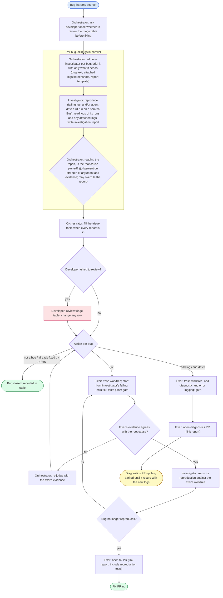

# Workflow: bug-fix

This workflow is a skill for the orchestrator: it shows how the developer wants
a list of bugs taken from report to "PR up". Follow its steps and decisions,
and use your own judgment for everything it leaves open: agent names, staffing,
and how to recover. It ends when the PR (or MR) is open. Review and merge are
separate; run auto-merge-pr afterwards only when the developer asks.

## Graph

Templates:

- Investigation report: `DOCS/templates/investigation-report.md`
- Triage table: `DOCS/templates/bug-triage-table.md`

## Steps in detail

1. **Assign.** Add one investigator per bug, with no limit on how many run at
   once. Brief each on a need-to-know basis: its bug's text, attached logs and
   screenshots, and the report template. No intake folders.
2. **Investigate.** The investigator works in the main checkout; no worktree.
   It is read-only except for reproduction: it may write failing tests that
   reproduce the bug, in new test files of its own, and must not touch source
   code or shared files. A failing test alone counts as a reproduction; an
   agent-driven UI run on a scratch Bus (e2e-test skill) is the other way.
   It reads the logs of its own runs and any logs attached to the bug, then
   fills in the investigation report. The report records facts and evidence
   only: no fix proposals, no priority, no verification plan.
3. **Judge.** Read each report and decide whether the root cause is pinned. It
   is a judgement call on the strength of the argument and evidence; you may
   contradict the report's own status. Choose the action: fix, add logs and
   defer, not a bug, or already fixed by PR #N.
4. **Optional developer review.** When every report is in, fill the triage
   table. If the developer asked to review, post it in MASTER and wait; they
   may change any row. Otherwise go straight on.
5. **Fix or add diagnostics.** A separate fixer agent creates a fresh worktree
   with worktree-new. For a fix, it starts from the investigator's failing
   tests (read from the main checkout and copied into its worktree), fixes the
   bug test-first until they pass, and runs gate-and-fix. If its evidence says
   the root cause is wrong, it stops and reports; re-judge. For a deferred bug,
   it adds diagnostic and error logging that would capture the missing
   evidence named in the report, and runs gate-and-fix.
6. **Verify.** The investigator stays in the main checkout and reruns its
   reproduction against the fixer's worktree path: the failing tests now pass
   and the UI repro, if any, no longer shows the bug. If the bug still
   reproduces, it goes back to the fixer. Once verified, the investigator
   deletes its test files from the main checkout so it stays clean.
7. **PR up.** The fixer opens the PR with the pr skill: the fix PR includes the
   reproduction tests and links the investigation report; a diagnostics PR
   links the report and names the evidence it is meant to capture.

Agents are not limited to their PWD: investigators verify against the fixer's
worktree without moving, and fixers read the investigator's tests from the
main checkout.

## Failure recovery

- **Bug not reproduced and evidence thin:** judge "not pinned"; the action is
  add logs and defer, or not a bug when the evidence says so.
- **Two investigations converge on one root cause:** give both bugs to one
  fixer and one PR; note it in the triage table.
- **Fixer contradicts the root cause:** re-judge with the fixer's evidence;
  send the bug back to the investigator if more evidence is needed.
- **Gate or disk limits:** many parallel bugs share one gate lock and one disk;
  fixers queue on the gate lock; keep the disk rules (free space before a full
  gate, delete target/ at worktree close).
- **Developer disagrees with a row:** apply their action; it overrides the
  orchestrator's judgement.

## Participants

| Role | Model | Does |
|---|---|---|
| Orchestrator | any | Adds and briefs agents, judges every report, fills the triage table, asks the review question once, assigns actions, recovers from the cases above. Does not investigate or fix. |
| Developer | - | Optionally reviews the triage table and changes rows. |
| Investigator + verifier | any (prefer Codex) | One per bug. Main checkout. Reproduces, writes the investigation report, later verifies the fix against the fixer's worktree. Writes only reproduction tests. |
| Fixer | any (prefer Codex) | Separate agent, own worktree per bug (or per shared root cause). Fixes test-first or adds diagnostics, runs the gate, opens the PR. |

## Worker brief messaging rule

Bus automatically adds `name (agent id, room R):` to agent-authored messages. Send only the body; do not add a "from X", "X here" or signature line.
Use `--as YOUR_AGENT_ID` when messaging; `--to orchestrator` reaches your home
room's bound orchestrator, and names or IDs can reach agents in any room.
