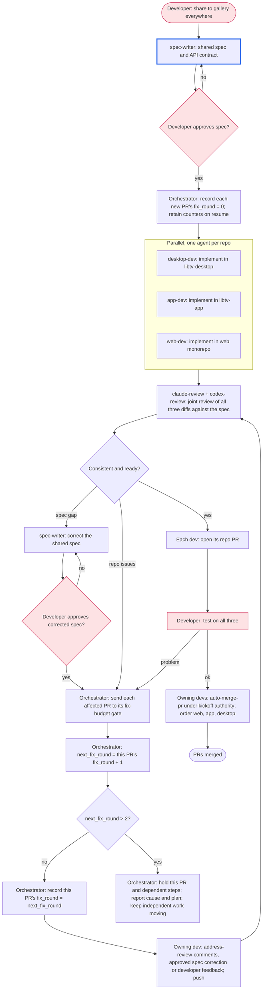

# Workflow: share-to-gallery across apps

<!-- Example. The same feature lands in several repositories at once: one
agent per repository works in parallel from a shared spec, a joint review
checks they agree, then each repository gets its own PR. -->

## Goal

"Share to gallery" works the same in libtv-desktop, libtv-app and the web
monorepo, each in its own merged PR, verified by the developer on all three.

## Non-goals

- Shared code between the repositories; each implements the spec natively.

## Graph

## Participants

| Agent | Provider | Role | Worktree / branch |
|---|---|---|---|
| spec-writer | claude | spec and API contract | spec file in the orchestrator folder |
| desktop-dev | claude | implement | libtv-desktop, feat/share-gallery |
| app-dev | codex | implement | libtv-app, feat/share-gallery |
| web-dev | cursor | implement | web monorepo, feat/share-gallery |
| claude-review, codex-review | claude, codex | joint review-pr | read-only, all three repos |

## Gates

- The developer approves the spec before any implementation starts.
- Each repository's own CI is green before the joint review.

## Coordination

- Separate repositories, so the devs never share files.
- A spec change goes back through the spec-writer and the developer, then to every
  dev it affects; no dev changes the contract alone.

## Decision rules

- Reviewers flag any behavior that differs between repositories; the spec
  decides, and a spec gap goes to the developer.
- Follow the binding orchestrator rules. Track at most two
  fix rounds per PR, including spec corrections and developer-test feedback;
  the initial review uses no round. A PR needing a third fix is held with its
  cause and plan reported; independent work continues. The second repaired
  head still receives joint review and requested developer acceptance.
- After requested developer acceptance passes, use `auto-merge-pr` in the
  order web, app, desktop under recorded kickoff authority. Carry each PR's
  consumed fix rounds and explicit holds into that workflow; merge only with
  every required review Ready, gates and requested acceptance passing on the
  exact head, comments adjudicated and no explicit hold.

## Log

- 2026-10-06: Drafted with the developer.

## Worker brief messaging rule

Bus automatically adds `name (agent id, room R):` to agent-authored messages. Send only the body; do not add a "from X", "X here" or signature line.
Use `--as YOUR_AGENT_ID` when messaging; `--to orchestrator` reaches your home
room's bound orchestrator, and names or IDs can reach agents in any room.
