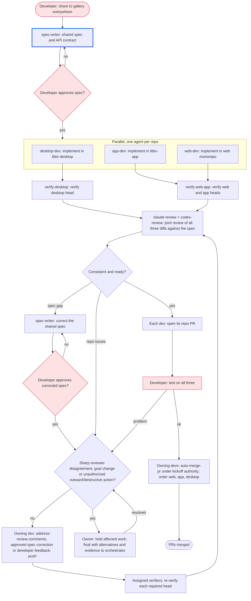

# Workflow: share-to-gallery across apps

<!-- Example. The same feature lands in several repositories at once: one
agent per repository works in parallel from a shared spec, a joint review
checks they agree, then each repository gets its own PR. -->

Each repository uses the **owner-run variant** of `auto-merge-pr`. Its PR owner
keeps fixing until every reviewer is Ready; the orchestrator mirrors status and
handles sharp reviewer disagreements and shared product decisions.

## Goal

"Share to gallery" works the same in libtv-desktop, libtv-app and the web
monorepo, each in its own merged PR, verified by the developer on all three.

## Non-goals

- Shared code between the repositories; each implements the spec natively.

## Graph

## Participants

| Agent | Provider | Role | Worktree / branch |
|---|---|---|---|
| spec-writer | claude | spec and API contract | spec file in the orchestrator folder |
| desktop-dev | claude | implement | libtv-desktop, feat/share-gallery |
| app-dev | codex | implement | libtv-app, feat/share-gallery |
| web-dev | cursor | implement | web monorepo, feat/share-gallery |
| verify-web-app | codex | verify web and app PRs | read-only, web and app worktrees |
| verify-desktop | claude | verify desktop PR | read-only, desktop worktree |
| claude-review, codex-review | claude, codex | joint review-pr | read-only, all three repos |

## Gates

- The developer approves the spec before any implementation starts.
- Each repository's own CI is green before the joint review.

## Coordination

- Separate repositories, so the devs never share files.
- A spec change goes back through the spec-writer and the developer, then to every
  dev it affects; no dev changes the contract alone.

## Decision rules

- Reviewers flag any behavior that differs between repositories; the spec
  decides, and a spec gap goes to the developer.
- Owners follow the owner-run variant and keep fixing until every reviewer is
  Ready, including approved spec corrections and developer-test feedback.
  Each repaired head receives joint review and requested developer acceptance.
  Hold and escalate sharp reviewer disagreements, goal changes, or destructive
  or outward-facing actions without existing authorization. Keep independent
  work moving while a decision is pending.
- After requested developer acceptance passes, use `auto-merge-pr` in the
  order web, app, desktop under recorded kickoff authority. Carry each PR's
  explicit holds into that workflow; merge only with every required review Ready, gates and requested acceptance passing on the
  exact head, comments adjudicated and no explicit hold.

## Log

- 2026-10-06: Drafted with the developer.

## Worker brief messaging rule

Bus adds one sender header: `name:` locally, `name (room R):` across rooms or MASTER; IDs appear only for numeric or historical names. Send only the body; do not add a "from X", "X here" or signature line.
Use `--as YOUR_AGENT_ID` when messaging; `--to orchestrator` reaches your home
room's bound orchestrator, and names or IDs can reach agents in any room.

PR peers: `<PR/task> → owner <name/ID> → verifier <name/ID> → reviewer(s) <name/ID>`.
Use these peers from your brief. If one is missing or replaced, message the
orchestrator; it owns staffing, room notes, the roster and verifier allocation.
Workers do not edit room notes or the roster. The brief carries the exact head,
worktree, acceptance checklist, locked goal/non-goals, pinned PR base,
recorded merge authority and explicit holds.

Message peers directly. The verifier sends `VERIFIED <PR/task> @<full SHA>`
with evidence, or defects with `file:line` and reproduction, straight to the
owner (the PR author). Use the task key and worktree head before a PR exists.
Reviewers send verdicts and findings to the owner. The owner re-sends the full
head to verifier and reviewers on every push and gets current-head evidence.

If you own a PR, use the owner-run path in `auto-merge-pr` and enforce these
checks before every repair batch and merge, including inside `merge-pr`:

- Keep fixing until every reviewer is Ready, with all other merge gates still
  required. Apply this to review, verification, gates, bots and developer feedback.
  Hold and escalate sharp reviewer disagreements, goal changes, and destructive
  or outward-facing actions without existing authorization to the orchestrator.
- Never fix a finding outside the PR's locked goal in this PR. Exclude it and
  report it in the final as a follow-up for the orchestrator to decide and record.
- Re-measure added plus removed lines against the pinned PR base, excluding
  `plans/`, after each push and **before merging**. At **3000 lines**, stop
  and send a final to the orchestrator for splitting; do not merge.
- Hand back **anything FLAGGED or needing a developer decision** to the
  orchestrator in a final. Stop this PR's merge path until it is resolved;
  owners do not adjudicate those items themselves.
- Merge only with exact-head `VERIFIED`, every required reviewer Ready, gates
  and requested acceptance passing, comments adjudicated, recorded authority,
  no unresolved FLAG/decision and no explicit hold. This does not extend a
  workflow that ends at PR creation or waive a draft-only hold.

Before editing shared files, message their owners and read the installed
[Parallel writes](../parallel-writes.md) at the resolved absolute session path
and ownership map supplied in your brief. Finals still go to the orchestrator;
after peer-started work, also send the milestone report to `--to orchestrator`.
Staffing and recovery, dialogs, product decisions and replacement announcements
stay with the orchestrator. It updates the roster/briefs and tells affected
peers the replacement's name/ID before work resumes.

For this three-PR example, `verify-web-app` verifies web and app, and
`verify-desktop` verifies desktop. Each brief names the repository owner, its
assigned verifier and both joint reviewers; joint review does not replace
per-PR verification. The orchestrator maintains these assignments.
