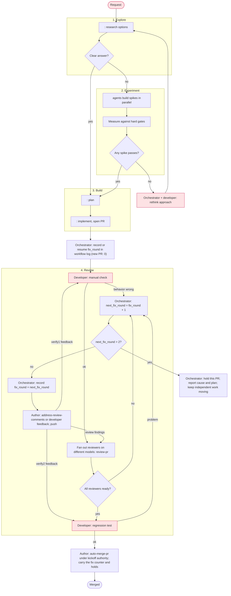

# Workflow: <room name>

<!--
A workflow is a living plan for one room (one unit of work). The orchestrator
drafts it with the developer before kickoff, follows it, and rewrites it whenever
the plan stops matching reality: a step fails, a gate cannot be met, or the
developer changes the requirements. Nothing executes this file. It is a shared
picture of the work, not a script.

Keep it short. Replace every <placeholder>. Delete sections that do not apply.
-->

## Goal

<What done looks like, in one or two sentences, and how the developer will check it.>

## Non-goals

- <Work that is explicitly out of scope for this room.>

## Graph

<!--
Nodes are agent tasks, diamonds are decisions, red nodes wait for the developer.
Group parallel work in a subgraph. Label edges with the condition that takes
them. Mark the node the room is currently on with :::current.
-->

Record the initiating check with each repair batch. Return review fixes directly
to review; return developer-feedback fixes only to the check that raised them.

## Participants

| Agent | Provider | Role | Worktree / branch |
|---|---|---|---|
| <name> | <claude/codex/cursor> | <coder, reviewer, tester> | <path or shared> |

Use different providers for reviewers. Keep a provider for review only once its
weekly allowance falls below about 25%.

## PR peers

The orchestrator copies this live roster to the room notes. Replace names/IDs in both the roster
and affected worker briefs whenever staffing changes; announce replacements
to their peers. Assign one verifier per 1–2 PRs.

| PR / task | Owner (name/ID) | Verifier (name/ID) | Reviewer(s) (name/ID) |
|---|---|---|---|
| <PR/task> | <owner> | <verifier> | <all required reviewers> |

## Gates

- <Hard gate that must hold before moving on, such as a benchmark threshold or green CI.>

## Coordination

- <Which agents share a branch, which need a worktree, and which files need
  "ask before you write" handoffs between agents.>
- <Worktree retention: which paths stay until which checkpoint; where required
  baselines and metrics are archived before cleanup.>
- <Delegate data-volume free-space checks at kickoff and each phase boundary;
  below 30 GiB, hold builds, benchmarks and large copies until cleanup restores space.>

## Decision rules

- <What the orchestrator may decide alone, and what must go to the developer.>
- Follow the binding orchestrator rules. Allow at most two
  fix rounds per PR, including developer feedback; review and verify the second
  repaired head before deciding whether it can merge. Hold a PR needing a third
  fix, report the cause and plan, and keep independent work moving.
- For technical disagreement, the author runs `best-of-n` and applies its
  top-ranked option for in-goal technical issues without a FLAG. Anything
  FLAGGED or needing a developer decision goes to the orchestrator in a final;
  it handles triage and takes product decisions to the developer.

## Log

<!-- Newest first. One line per change to this workflow, with the reason. -->

- <date>: Drafted with the developer.

## Worker brief messaging rule

Bus adds one sender header: `name:` locally, `name (room R):` across rooms or MASTER; IDs appear only for shared or numeric names. Send only the body; do not add a "from X", "X here" or signature line.
Use `--as YOUR_AGENT_ID` when messaging; `--to orchestrator` reaches your home
room's bound orchestrator, and names or IDs can reach agents in any room.

PR peers: `<PR/task> → owner <name/ID> → verifier <name/ID> → reviewer(s) <name/ID>`.
Use these peers from your brief. If one is missing or replaced, message the
orchestrator; it owns staffing, room notes, the roster and verifier allocation.
Workers do not edit room notes or the roster. The brief carries the exact head,
worktree, acceptance checklist, locked goal/non-goals, pinned PR base,
inherited `fix_round`, recorded merge authority and explicit holds.

Message peers directly. The verifier sends `VERIFIED <PR/task> @<full SHA>`
with evidence, or defects with `file:line` and reproduction, straight to the
owner (the PR author). Use the task key and worktree head before a PR exists.
Reviewers send verdicts and findings to the owner. The owner re-sends the full
head to verifier and reviewers on every push and gets current-head evidence.

If you own a PR, use the owner-run path in `auto-merge-pr` and enforce these
checks before every repair batch and merge, including inside `merge-pr`:

- Carry the inherited fix-round counter and record each batch in the PR repair
  log. Allow at most **2 fix rounds** across review, verification, gates, bots
  and developer feedback. If another repair is needed after round 2, stop and
  send a final with the count, cause and plan to the orchestrator.
- Never fix a finding outside the PR's locked goal in this PR. Exclude it and
  report it in the final as a follow-up for the orchestrator to decide and record.
- Re-measure added plus removed lines against the pinned PR base, excluding
  `plans/`, after each push and **before merging**. At **3000 lines**, stop
  and send a final to the orchestrator for splitting; do not merge.
- Hand back **anything FLAGGED or needing a developer decision** to the
  orchestrator in a final. Stop this PR's merge path until it is resolved;
  owners do not adjudicate those items themselves.
- Merge only with exact-head `VERIFIED`, every required reviewer Ready, gates
  and requested acceptance passing, comments adjudicated, recorded authority,
  no unresolved FLAG/decision and no explicit hold. This does not extend a
  workflow that ends at PR creation or waive a draft-only hold.

Before editing shared files, message their owners and read the installed
[Parallel writes](../parallel-writes.md) at the resolved absolute session path
and ownership map supplied in your brief. Finals still go to the orchestrator;
after peer-started work, also send the milestone report to `--to orchestrator`.
Staffing and recovery, dialogs, product decisions and replacement announcements
stay with the orchestrator. It updates the roster/briefs and tells affected
peers the replacement's name/ID before work resumes.
