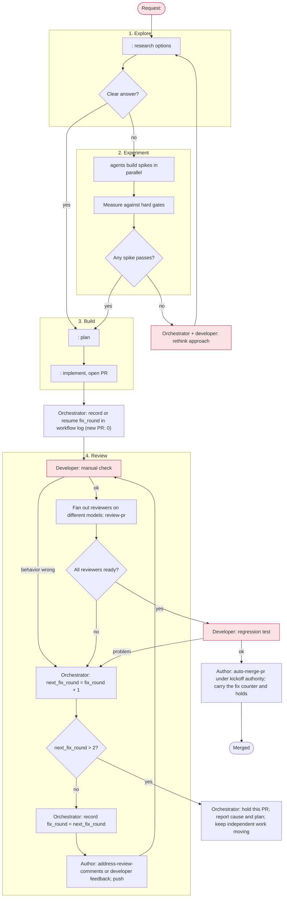

# Workflow: <room name>

<!--
A workflow is a living plan for one room (one unit of work). The orchestrator
drafts it with the developer before kickoff, follows it, and rewrites it whenever
the plan stops matching reality: a step fails, a gate cannot be met, or the
developer changes the requirements. Nothing executes this file. It is a shared
picture of the work, not a script.

Keep it short. Replace every <placeholder>. Delete sections that do not apply.
-->

## Goal

<What done looks like, in one or two sentences, and how the developer will check it.>

## Non-goals

- <Work that is explicitly out of scope for this room.>

## Graph

<!--
Nodes are agent tasks, diamonds are decisions, red nodes wait for the developer.
Group parallel work in a subgraph. Label edges with the condition that takes
them. Mark the node the room is currently on with :::current.
-->

## Participants

| Agent | Provider | Role | Worktree / branch |
|---|---|---|---|
| <name> | <claude/codex/cursor> | <coder, reviewer, tester> | <path or shared> |

Use different providers for reviewers. Keep a provider for review only once its
weekly allowance falls below about 25%.

## Gates

- <Hard gate that must hold before moving on, such as a benchmark threshold or green CI.>

## Coordination

- <Which agents share a branch, which need a worktree, and which files need
  "ask before you write" handoffs between agents.>
- <Worktree retention: which paths stay until which checkpoint; where required
  baselines and metrics are archived before cleanup.>
- <Delegate data-volume free-space checks at kickoff and each phase boundary;
  below 30 GiB, hold builds, benchmarks and large copies until cleanup restores space.>

## Decision rules

- <What the orchestrator may decide alone, and what must go to the developer.>
- Follow the binding orchestrator rules. Allow at most two
  fix rounds per PR, including developer feedback; review and verify the second
  repaired head before deciding whether it can merge. Hold a PR needing a third
  fix, report the cause and plan, and keep independent work moving.
- For technical disagreement, the author runs `best-of-n` and applies its
  top-ranked option; only a question it hands back goes to the developer.

## Log

<!-- Newest first. One line per change to this workflow, with the reason. -->

- <date>: Drafted with the developer.
